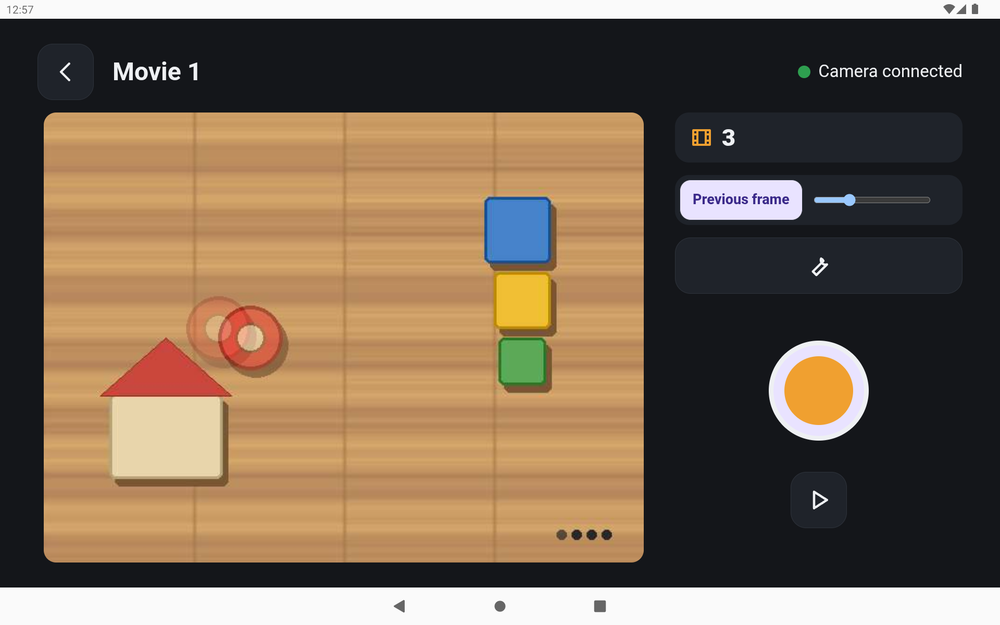

# Kopernikadr

A home stop-motion rig for a kid. A phone hangs lens-down over a table and works as the camera;
a tablet or laptop is the remote: live preview, onion skin, frame strip, playback and video
export. No app store: everything is installed with `adb` or as an APK.

Status (2026-10-27): the phone camera app works, and the native tablet app (`remote/`) is built:
projects, shooting with onion skin, playback, the frame strip, editing, emoji stickers and export
to the gallery (stages 1+2 and 3a). It is tested on an emulator against a fake camera; the session
on the real tablet and phone is still to do. The browser remote on the phone, **remote-lite**,
still works and is the fallback. Next: stage 3b (insert, reshoot, copy/paste, reverse), then more
effects ([roadmap](docs/ROADMAP.md)).



**Stack:** Kotlin · CameraX · Ktor (phone camera app) · Next.js static export + Capacitor 8 (tablet app) · a versioned JSON protocol between them, with fixtures and a fake camera for tests

Docs: [requirements](docs/PROMPT.md) · [architecture](docs/ARCHITECTURE.md) ·
[protocol](protocol/PROTOCOL.md) · [roadmap](docs/ROADMAP.md) · [plans](docs/plans/) ·
[on-device acceptance](docs/ACCEPTANCE.md)

## Repository layout

| Path | What |
|---|---|
| `camera-android/` | The phone app (Kotlin, CameraX, Ktor). `:core` is a plain JVM module with all pure logic, the server routes, the spool and the remote-lite web files; `:app` is the Android app (camera adapters, UI, probes) |
| `camera-android/core/src/main/resources/remote-lite/` | remote-lite: the browser remote the phone serves on `/` |
| `protocol/` | `PROTOCOL.md` (v1, frozen 2026-10-27), `fixtures/*.json`, and `tools/probe-client/` (a Mac CLI + a fake camera) |
| `packages/remote-core/` | Shared JS (protocol client, connection, preview, backoff, i18n helpers) used by remote-lite and the native remote |
| `remote/` | The native tablet remote (Next.js static export + Capacitor 8 Android); `remote/e2e/` is the emulator test script |
| `scripts/` | `build.sh`, `install.sh`, `collect-diagnostics.sh`, `meminfo-sampler.sh` (+ `lib.sh`, and `test/run.sh` with a fake `adb`) |
| `docs/` | Requirements, architecture, roadmap, plans, diagnostics summaries, acceptance checklists |

## Build

You need:
- **Android Studio** (for its SDK and its bundled JBR). No system JDK is needed:
  `camera-android/gradlew-jbr` runs `./gradlew` with Android Studio's JBR, sets `ANDROID_HOME`
  (default `~/Library/Android/sdk`) and writes `local.properties` if it is missing.
- **Node 22** (for remote-lite tests, the probe-client and the fake camera).
- `adb` is not on `PATH` on this Mac: use `~/Library/Android/sdk/platform-tools/adb` (or add that
  directory to `PATH`).

```sh
cd camera-android
./gradlew-jbr :core:test :app:testDebugUnitTest   # unit tests
./gradlew-jbr :app:assembleProbe                  # → app/build/outputs/apk/probe/app-probe.apk
```

Pinned versions and why some are held back: [camera-android/VERSIONS.md](camera-android/VERSIONS.md).

**Segmenter model (remote, once per machine).** The photo-sticker cut-out needs a 30.5 MB MediaPipe
model that is not in the repo. `scripts/build.sh` and `npm run android:debug` fetch it for you; by hand
run `cd remote && npm run models` (`node scripts/fetch-models.mjs`: it downloads the pinned URL, checks
the sha256, caches it in `~/.kopernikadr/models/` and copies it into the ignored
`remote/android/app/src/main/assets/mediapipe/`). A plain `gradlew assembleDebug` without it fails with
this hint. Details: [remote/VERSIONS.md](remote/VERSIONS.md).
JS tests: `npm test --workspaces` at the root (run `npm ci` once first).

### Build the APKs (`scripts/build.sh`)

```sh
scripts/build.sh                                  # camera + remote, release → dist/
scripts/build.sh --camera-only --variant probe    # dist/kopernikadr-camera-probe.apk
scripts/build.sh --remote-only --variant debug    # dist/kopernikadr-remote-debug.apk
```

Output: `dist/kopernikadr-<camera|remote>-<release|probe|debug>.apk` (git-ignored). The remote
build runs `npm run build` (Next static export) → `npx cap sync android` → Gradle; run `npm ci`
at the repo root once first. The remote has no `probe` build type. **Release** needs the release
keystore (below); without it `build.sh` refuses to build, because an unsigned release APK can't
be installed. After each build it prints the signer certificate's SHA-256, so a wrong key is
visible before installing.

### Release keystore (create once, then back it up)

Both apps' release builds are signed with one key, kept **outside the repo** in `~/.kopernikadr/`.
The Gradle files read `~/.kopernikadr/keystore.properties` (or the file named by
`KOPERNIKADR_KEYSTORE_PROPERTIES`); without it the release build type stays unsigned. The
`debug` and `probe` builds keep the debug key.

> **Losing the key means losing data.** Android only upgrades an app with an APK signed by the
> same key. With another key the only way to install is to uninstall first, which deletes the
> camera's frames and the remote's projects. Back the key up before the first install.

1. Create it with Android Studio's `keytool` (it asks for a password; PKCS12 uses the same
   password for the store and the key):

   ```sh
   mkdir -p ~/.kopernikadr && chmod 700 ~/.kopernikadr
   "/Applications/Android Studio.app/Contents/jbr/Contents/Home/bin/keytool" -genkeypair -v \
     -keystore ~/.kopernikadr/release.jks -alias kopernikadr \
     -keyalg RSA -keysize 4096 -validity 36500 -dname "CN=Kopernikadr"
   ```

2. Write `~/.kopernikadr/keystore.properties` (`storeFile` is absolute or relative to this
   file), then `chmod 600 ~/.kopernikadr/keystore.properties`:

   ```properties
   storeFile=release.jks
   storePassword=<the password>
   keyAlias=kopernikadr
   keyPassword=<the same password>
   ```

3. **Back up** `release.jks` and the password to two places off this Mac (for example the
   password manager, as an attachment, and an encrypted USB stick). Check the backup opens and
   note its fingerprint:

   ```sh
   "/Applications/Android Studio.app/Contents/jbr/Contents/Home/bin/keytool" -list -v \
     -keystore /path/to/backup/release.jks | grep SHA256
   ```

   It must match the `SHA-256 digest` that `build.sh` prints. Never commit the keystore or the
   passwords (`*.jks`, `*.keystore` and `keystore.properties` are git-ignored).

### Camera app variants

| Build type | Package | Notes |
|---|---|---|
| `debug` | `pl.slava.kopernikadr.camera.debug` | Debuggable, with diagnostics |
| `probe` | `pl.slava.kopernikadr.camera.probe` | Release-like (non-debuggable), signed with the debug key, with diagnostics. **The kid's phone runs this build today** |
| `release` | `pl.slava.kopernikadr.camera` | No diagnostics code. Signed with the release key (`~/.kopernikadr`) |

The three packages are separate apps with separate data; they can sit side by side. Moving the
kid to the release build means a new app with an empty spool: the frames stay in the probe app
(so don't uninstall it). The remote has `debug` (`pl.slava.kopernikadr.remote.debug`) and
`release` (`pl.slava.kopernikadr.remote`).

### Install (`scripts/install.sh`)

```sh
scripts/install.sh                                   # release: camera on the phone, remote on the tablet
scripts/install.sh --camera-only --variant probe     # the kid's current build
scripts/install.sh --remote-only --serial HA1XXXXX   # one device by serial
```

It installs `dist/` APKs (from `build.sh`) and picks devices by `ro.product.model` substring:
`g05` → camera phone, `TB328` → tablet. If any unknown model is connected it stops (pick a device
with `--serial`); several matching devices also need `--serial`. With `--serial` and no
`--*-only`, it installs the app that matches that device. Emulators count as the tablet only with
`--allow-emulator` (testing). Every target is resolved before anything is installed.

It always runs `adb -s <serial> install -r` (an in-place upgrade) and **never uninstalls or
clears data**. Any `Failure [` stops it with a non-zero exit and a loud message, for example
`INSTALL_FAILED_UPDATE_INCOMPATIBLE` (the APK is signed with another key: rebuild with the key
from your backup) or `INSTALL_FAILED_VERSION_DOWNGRADE` (the device has a newer `versionCode`).
Tests: `scripts/test/run.sh` (plain bash, a fake `adb`).

### Install by hand (Gradle / adb)

```sh
cd camera-android
./gradlew-jbr :app:installProbe        # build + install the probe build
# or, with an APK you already have:
~/Library/Android/sdk/platform-tools/adb install -r app/build/outputs/apk/probe/app-probe.apk
```

With more than one device connected, pick one with `ANDROID_SERIAL=<serial>` (Gradle) or
`adb -s <serial>`.

> **Never uninstall the camera app.** Its spool holds every frame the kid has shot; uninstalling
> deletes them. Always upgrade in place (`install -r`, or the Gradle install task). If an install
> fails with `INSTALL_FAILED_UPDATE_INCOMPATIBLE`, stop and ask; don't uninstall to "fix" it.

## Using it: the tablet app

For the parent. The kid's remote is the **Kopernikadr** app on the tablet.

1. Put the phone on the rig, on the same Wi-Fi as the tablet, and open **Kopernikadr Kamera**.
   Keep it open with the screen on: the camera works only while the app is in the foreground.
2. On the tablet, open **Kopernikadr**. It finds the phone by itself (or type the address shown
   on the phone's screen on the connect screen). A badge shows whether the camera is online.
3. What the kid does:
   - **Projects:** the first screen is the list of her movies, big cards with a cover and the
     frame count. The "new movie" card starts a movie. Tap a card to shoot or to watch.
   - **Capture:** live preview, the faint previous frame over it (onion skin), the big shutter
     button and the frame counter. "Play" opens playback, the back arrow returns to the movies.
   - **Play and edit:** the movie screen shows the movie, the buttons on the right and the frame
     strip at the bottom. Tap a frame to select it (tap again for a big view). The tools:
     **Usuń** (delete a frame; Undo for 5 seconds), **Powiel** (copy), **Dłużej / Krócej** (show it
     1 to 8 ticks), **Wcześniej / Później** (move), **Wyłącz / Włącz** (keep the frame but leave it
     out of the movie), **Od tego / Do tego** (trim: leave out everything before / after), and
     **Cofnij** (undo the last edit, up to 30). Nothing here changes the photos: edits only change
     what plays, and turned-off frames are kept. A frame shot later goes to the end.
   - **Emoji:** select a frame and tap **+ Emoji**, pick one of 242 emoji (tabs by category). It
     appears on that frame and on every frame after it up to the end of the movie (frames shot
     later do not get it). Drag it to move it, drag the corner handle to resize and rotate it, tap
     the trash button to remove it. With the emoji selected, tap another frame and use **Od tego
     kadru / Do tego kadru** to shorten or extend the range. The emoji are drawn in playback and
     in the video.
   - **Zrób naklejkę** (a sticker from a toy): in the emoji picker open the **Moje** tab and tap
     "Zrób naklejkę". Take a photo with the tablet camera ("Zrób zdjęcie") or pick one ("Z galerii").
     Tap the toy, or draw over it, and the tablet cuts it out (the first cut of a picture takes a few
     seconds); fix the edge with **Dodaj** / **Usuń** and **Cofnij**, then pick a style ("Naklejka" or
     "Komiks") and save. A PNG with a transparent background skips the cut. The sticker then behaves like
     an emoji. A copy goes into the movie, so deleting it from "Moje" (the x on its tile) does not break
     movies that use it. Stickers stay only on the tablet.
   - **Play:** the movie plays at its frame rate. The export button saves a video.
   - **Export:** the video is encoded on the tablet and saved to the gallery, in
     **`Movies/Kopernikadr`**, as `kopernikadr-<name>-<date>.mp4`. The dialog says "Zapisano w
     galerii" when it is done. Cancel works only while it is encoding.
   - **Deleting a movie** can be undone for 5 seconds.
4. **Parent drawer:** **long-press the wrench** on the capture screen (about 1.5 seconds). It has
   the exposure, white balance and focus locks (set the light first, then lock), exposure
   compensation, the camera rotation (0/180, only for a movie with no frames yet), preview
   quality, frames per second, the grid, and the transfer queue, storage and frames that could
   not be downloaded. The Diagnostics screen (`#/diagnostics`) is for probes. It is opened by a
   long-press on the wrench on the movies screen, and it also has the **quarantine** section
   (photos that failed the check after download; see below) and "O aplikacji" with the OpenMoji
   attribution (CC BY-SA 4.0) and the MediaPipe / MagicTouch model credit (Apache 2.0).
5. Each frame goes to the tablet right after it is shot, and only then does the phone's copy
   become removable. The phone deletes a frame it already handed over only when it runs low on
   space.

Things to know:
- **Where the movies are:** the frames and projects are inside the tablet app; the finished
  videos are in the gallery (`Movies/Kopernikadr`).
- **Uninstalling the remote deletes its movies** (the frames and projects; the videos already in
  the gallery stay). There is no backup in v1.
- **remote-lite still works** as a fallback on the same phone (open `http://<phone-ip>:8765/` in
  a browser, see below). Its movies are not imported into the app: they stay on the phone and in
  that browser.
- **"Frames of other remotes":** the camera counts unacknowledged frames that belong to another
  remote, for example every movie shot with remote-lite, in its status (`orphanCount`). They are
  never deleted by the camera app and never sent to the tablet app. (The phone's screen doesn't
  show this count.)
- **Before upgrading the camera app on the kid's phone, back up its frames.** The new camera build
  runs a recovery at start (it moves a stray `full` file to a `quarantine/` folder rather than
  deleting it), and the phone holds the only copy of the remote-lite movies. Upgrade only in
  place (`install -r`, never uninstall), and first download every `full` of remote-lite's
  `clientId` from the camera's HTTP API (read-only, **do not ack**) and check the sha256 values;
  compare `getStatus` counts before and after. This step is not scripted yet.

## Using remote-lite (the fallback)

1. Put the phone on the rig, on the same Wi-Fi as the tablet/laptop, and open
   **Kopernikadr Kamera**. Keep the app open with the screen on: the camera works only while the
   app is in the foreground.
2. The phone screen shows the address and a QR code. Scan the QR with the tablet's or laptop's
   camera, or open `http://<phone-ip>:8765/` in Chrome. (If port 8765 is busy, the phone picks
   another one and shows it.)
3. Create a movie and shoot. Onion skin ("Duszek"), the frame strip, delete + Undo and playback
   are on the capture screen.
4. **Save a video** in playback: the browser records it and saves an MP4 (WebM if the browser
   can't record MP4) to its Downloads.

One remote controls the camera at a time. If the remote is opened in another tab or on another
device, the old one pauses and shows **"Przejmij"** (take over) to get the camera back.

Lighting tips:
- Set the light first, then lock exposure, white balance and focus in parent mode: **hold the
  gear for 2 seconds** on the capture screen.
- Use constant artificial light. Daylight changes during a session and makes the movie flicker.
  Mains light in Poland is 50 Hz; if LED lights flicker in the frames, try other lamps.
- After moving the lamps, unlock and lock again.

Frames stay on the phone for now (see Known limitations).

## Development

### Tests

```sh
# from the repo root
(cd camera-android && ./gradlew-jbr :core:test :app:testDebugUnitTest)   # Kotlin
node --test 'camera-android/core/src/test/remote-lite/*.test.mjs'       # remote-lite
(cd protocol/tools/probe-client && node --test)                         # probe-client + fake camera
scripts/test/run.sh                                                      # build/install/collect scripts (fake adb)
```

### remote-lite against the fake camera

The fake camera (`protocol/tools/probe-client/fake-camera.mjs`) implements enough of the protocol
to drive remote-lite on the Mac. Serve the **merged** resources dir, the same files the APK
ships:

```sh
cd camera-android && ./gradlew-jbr :core:processResources && cd ..
node protocol/tools/probe-client/fake-camera.mjs \
  --serve camera-android/core/build/resources/main/remote-lite --port 8765
# open http://localhost:8765/
```

The header of `fake-camera.mjs` lists the `/fake/*` knobs for failure tests (kick sockets, drop a
capture answer, fail a lock, slow or failing `play` frames).

### probe-client

A dependency-free Mac CLI for the camera server: `info`, `hello`, `capture`, `preview`,
`download` against the phone or the fake camera. See
[protocol/tools/probe-client/README.md](protocol/tools/probe-client/README.md). Its `probe`
command needs the `/diag` routes, which the camera app doesn't have yet.

### Diagnostics

- Phone (debug/probe builds): hold the title on the phone's status screen for 3 s to open the
  parent screen, and tap "Diagnostyka" there for the diagnostics screen (the `caps` probe). Reports go to the app's external files dir, `diag/`,
  readable with `adb pull` on the probe build too.
- `scripts/collect-diagnostics.sh [--serial S]` pulls the reports (read-only) from every known
  device into `diagnostics/<YYYY-MM-DD>/<kind>-<model>-<serial>/<package>/` (git-ignored): the
  camera's `files/diag/` of the probe and debug builds, and the remote's `files/` (release and
  debug). Summaries go to `docs/diagnostics/`.
- `scripts/meminfo-sampler.sh --serial S --package P [--seconds N] [--out f.csv]` samples
  `dumpsys meminfo` TOTAL PSS of the app and of its WebView sandboxed renderer about once a
  second → CSV `ts,app_pss_kb,renderer_pss_kb,total_kb`; on Ctrl-C or after N seconds it writes
  `<out>.summary.txt` with the peaks. Default output: `diagnostics/<date>/meminfo-<pkg>-<time>.csv`.
- The native remote has a Diagnostics view (`#/diagnostics`) that runs the probes (environment,
  NSD, camera, reconnect, download, video frame, export) and writes a report.

## Parent checklist (Family Link) — draft

Both devices are supervised child devices. The paths below are the Polish menus seen on the
devices. Never try to bypass supervision.

**1. Developer mode, on each device**
- Ustawienia → Informacje o telefonie (on the tablet: Informacje o tablecie) → tap
  **Numer kompilacji** 7 times. The device may ask for the parent's approval.

**2. In the Family Link app (parent's phone), for each child device**
- Ustawienia urządzenia → **Opcje programisty** → allow.
- Ustawienia urządzenia → **Aplikacje z nieznanych źródeł** → allow (needed to install APK
  files).

**3. USB debugging, on the device**
- Ustawienia → System → Opcje programisty → **Debugowanie USB** → on.
- First USB connection: the device asks to trust the computer's RSA key → allow (tick "always
  allow from this computer" on your own Mac).
- Motorola: if the Mac doesn't see the phone (`adb devices` is empty), pull down the USB
  notification and choose **Przesyłanie plików**.

**4. Afterwards**
- You can turn off **Opcje programisty** and **Aplikacje z nieznanych źródeł** in Family Link
  once the apps are installed. Trade-off: every update needs them back on (USB debugging for
  `adb`, unknown sources for an APK file).

**5. Network**
- Give the phone a **DHCP reservation** on the router, so its address, and so the URL and QR,
  stay the same.

**6. Every session**
- Open the camera app and keep it open with the screen on. There is no background camera: when
  the phone locks or the app goes to the background, shooting stops (nothing captured is lost)
  and resumes when the app is back.

**7. Don't uninstall**
- **Uninstalling an app deletes its data.** The camera app holds the frames that are not yet
  removed, and the native remote holds all projects and frames, with no backup in v1 (finished
  videos in the gallery stay). remote-lite keeps projects in the browser, so clearing that
  browser's site data deletes them too.
- Keep the release keystore backed up (see [Release keystore](#release-keystore-create-once-then-back-it-up)):
  without it an update can't be installed over the existing apps.

**8. Limits, downtime and "Always allowed"**
- *To be filled after the tablet session (plan 0b, Task 14):* how both apps behave under the
  daily limit, an app limit, downtime, the parent's manual lock and an ordinary screen lock, and
  what "Always allowed" covers.

## Known limitations (today)

- The phone deletes the files of a frame the tablet app already acknowledged 7 days after the
  acknowledgement (checked hourly), or earlier when it runs low on space. **The first launch
  after upgrading the camera app deletes, in one go, every frame acknowledged more than 7 days
  ago, including ones acknowledged by an earlier install. Back up the phone's spool before
  that install.** Frames shot with remote-lite are never acknowledged and never deleted: that
  spool grows.
- remote-lite's projects live in the browser that created them (its local storage). Another
  browser or device sees an empty list; clearing site data deletes them.
- The tablet app cannot yet insert a frame in the middle, reshoot frame N, copy and paste frames
  or reverse a range (stage 3b). Stickers do not move by themselves yet.
- **Where quarantine is cleared.** The `quarantine/` folders hold files that could not be
  accounted for. A file there may be the only copy of a photo, so nothing deletes them
  automatically. On the **tablet**: long-press the wrench on the movies screen, then
  "Kwarantanna zdjęć" shows the count, the size and up to 12 thumbnails; "Wyczyść" asks for the
  answer to a small multiplication. On the **phone**: hold the title on the status screen for 3
  seconds to open the parent screen, which has the same card. Clearing is permanent.
- A movie with photo stickers (`my:`) plays in an older tablet app but that app cannot export it:
  install the newer build to export.
- The Android build of the tablet app includes MediaPipe, which brings a Google telemetry component
  (`transport-backend-cct`); it is not verified whether it sends anything. Segmentation itself uses
  no network.
- Edits and stickers are stored only by the tablet app. If you install an older tablet app over
  a newer one, its first save drops them (the photos stay and the movie goes back to shoot order);
  install the newer app again before editing.
- The phone dims its screen after 2 minutes without a touch or a command from the tablet (the
  preview alone does not count). It never dims while the waiting card with the QR code is
  shown, and any touch or capture wakes it.
- One controller at a time; a second remote takes over and pauses the first ("Przejmij").
- remote-lite has no discovery: use the QR or type the address. The tablet app finds the phone
  by NSD; there is no QR deep link.
- The camera works only while its app is in the foreground with the screen on.
- Both apps target SDK 36. Targeting SDK 37+ (Android 17) would need the local-network
  permission; we don't need 37 while sideloading.
- Server details such as `HEAD` support and `503` + `Retry-After` (while a frame's smaller copy
  is still being made) are internal: remote-lite retries on its own, users don't need them.

---

Built by [Wiaczeslaw Cyunczyk](https://tslava.dev)
